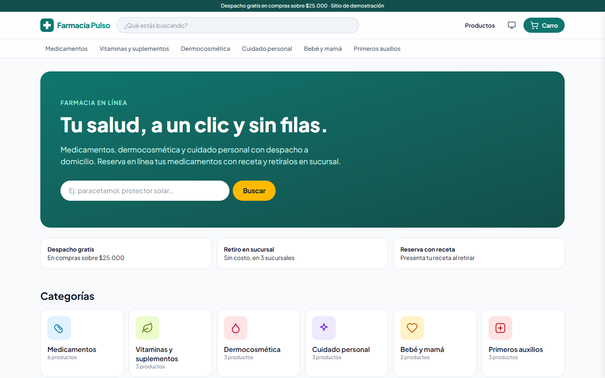
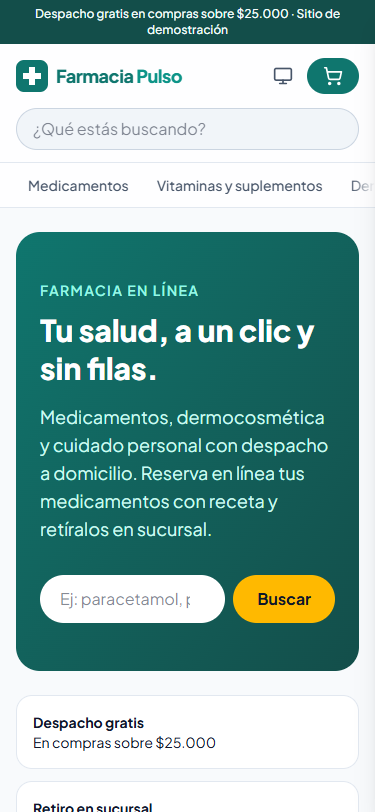
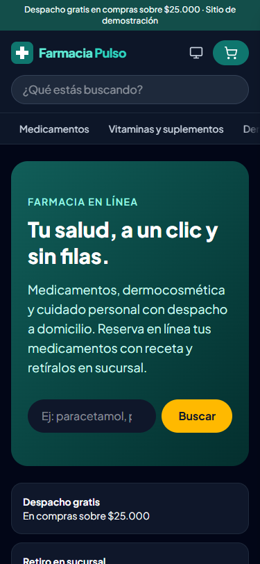

# Farmacia Pulso

Tienda en línea de una farmacia **ficticia**, construida como proyecto de portafolio con [Astro](https://astro.build), islas de React y carro de compras persistente.

**Demo:** https://alexperez7.github.io/farmacia-astro/

> Farmacia Pulso es una marca inventada. Los productos, precios, laboratorios y sucursales son ficticios. No se venden medicamentos ni se procesan pagos.

## Funcionalidades

- **Catálogo estático** generado desde una Content Collection (`src/data/productos.json`) validada con Zod.
- **Búsqueda difusa** (Fuse.js) por nombre, principio activo y laboratorio, con la búsqueda reflejada en la URL (`?q=`).
- **Filtros** por categoría, laboratorio, precio máximo, venta directa y stock; orden por precio, descuento o nombre.
- **Carro de compras** con [nanostores](https://github.com/nanostores/nanostores): panel lateral, cantidades limitadas por stock, persistencia en `localStorage` y sincronización entre pestañas.
- **Despacho gratis** sobre $25.000 con barra de progreso.
- **Medicamentos con receta**: no se cobran en línea, se *reservan* para retiro en sucursal (simula la regulación chilena de venta de fármacos).
- **Checkout simulado** con validación de RUT (módulo 11), teléfono chileno, despacho o retiro, y página de confirmación.
- **Modo oscuro** con interruptor Sistema / Claro / Oscuro, sin destello al cargar, construido sobre colores semánticos (`bg-superficie`, `text-texto`…) con contraste WCAG AA en ambos temas.
- **Responsivo desde 320 px** hasta escritorio, con áreas táctiles de 40 px como mínimo y soporte del área segura del iPhone.
- Accesible (labels, `aria-*`, foco, `prefers-reduced-motion`) y SEO por página.

## Capturas

| Claro | Oscuro |
|---|---|
|  |  |
|  |  |

## Cómo se trabaja

Cada cambio se describe primero en una spec (`docs/specs/`), se aprueba y luego se implementa. El plan y el registro están en [PLAN.md](PLAN.md); las reglas para agentes en [AGENTS.md](AGENTS.md).

## Arquitectura

Todo el sitio es HTML estático; solo se hidratan las partes interactivas:

| Isla | Directiva | Por qué |
|---|---|---|
| `CarroBoton`, `CarroDrawer`, `CarroPagina`, `Checkout` | `client:only` | Dependen de `localStorage`; no tiene sentido renderizarlas en el build |
| `Catalogo` | `client:load` | Filtros y búsqueda inmediatos |
| `ProductoCard` (destacados, relacionados) | `client:visible` | Se hidrata al entrar en pantalla |

```
src/
├─ content.config.ts       # esquema de productos
├─ data/productos.json     # catálogo
├─ stores/carro.ts         # estado del carro (nanostores + localStorage)
├─ lib/                    # categorías, reglas de tienda, RUT, URLs con base
├─ components/             # islas y componentes React
├─ layouts/Base.astro
└─ pages/                  # inicio, productos, categoría, carro, checkout, confirmación
```

## Desarrollo

```bash
npm install
npm run dev       # http://localhost:4321/farmacia-astro/
npm run build     # genera dist/
npm run preview
```

## Despliegue

El workflow `.github/workflows/deploy.yml` publica en GitHub Pages en cada push a `main`. En el repositorio: **Settings → Pages → Source: GitHub Actions**.

Como es un sitio de proyecto, `astro.config.mjs` define `base: '/farmacia-astro/'` y todos los enlaces pasan por `url()` (`src/lib/url.ts`).

## Stack

Astro 7 · React 19 · Tailwind CSS 4 · nanostores · Fuse.js · TypeScript
